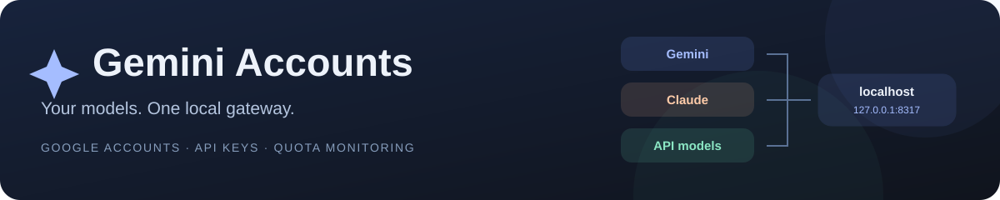
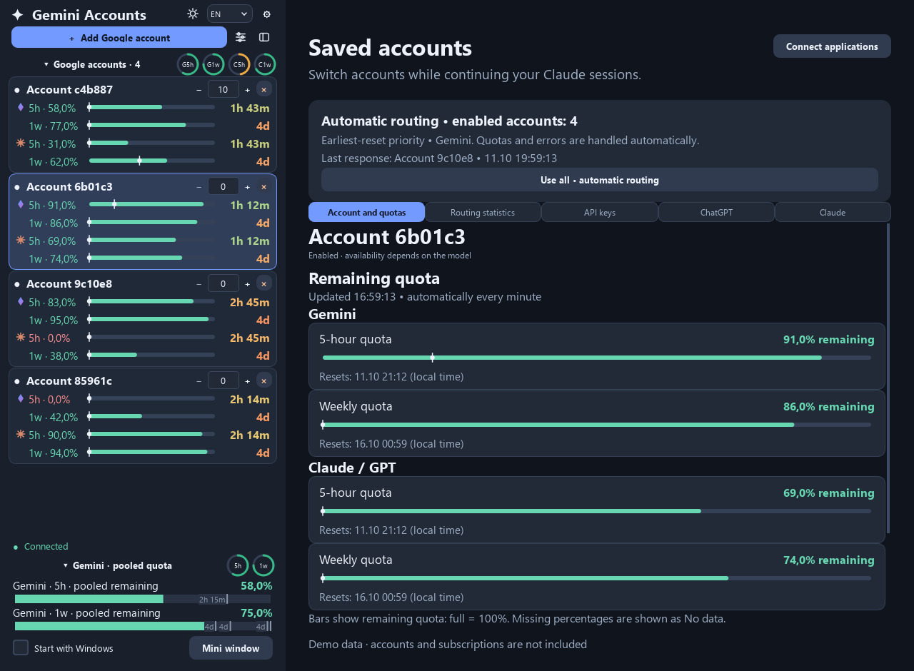
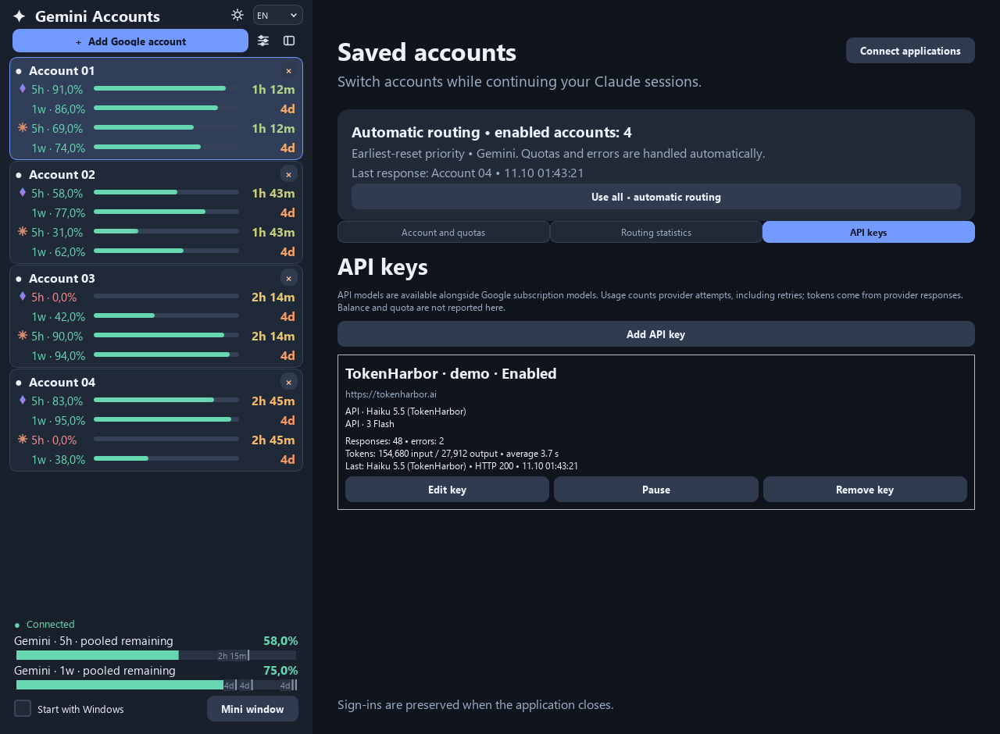
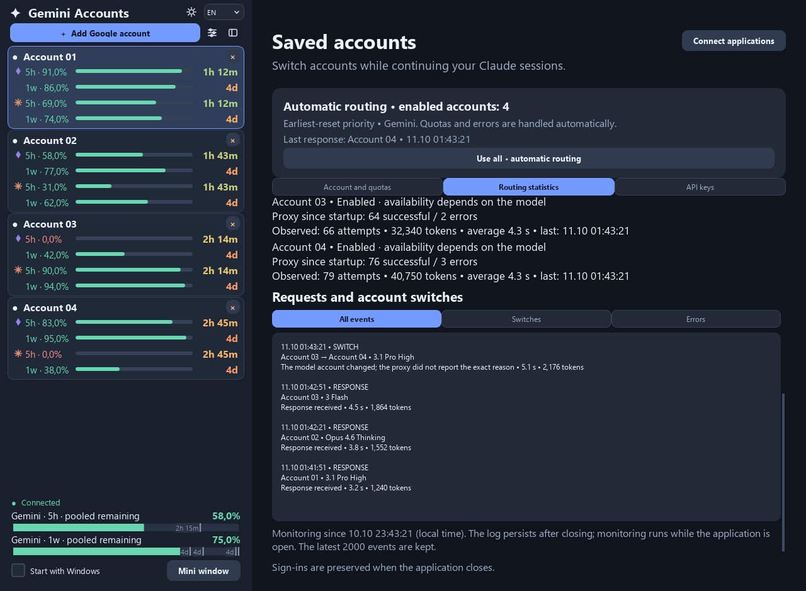
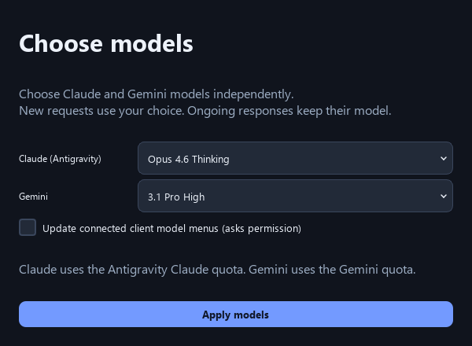
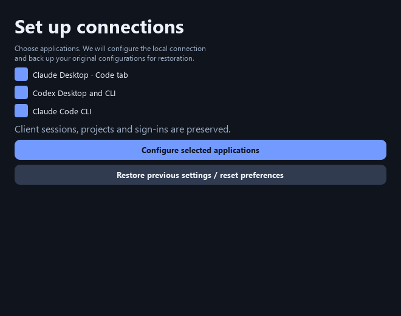
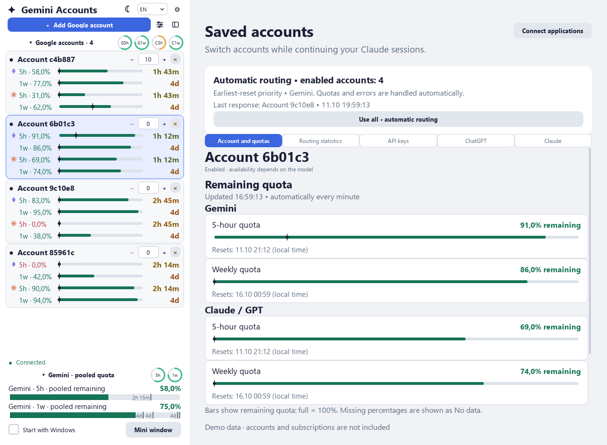
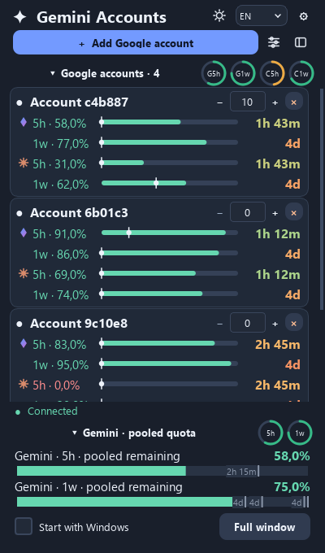
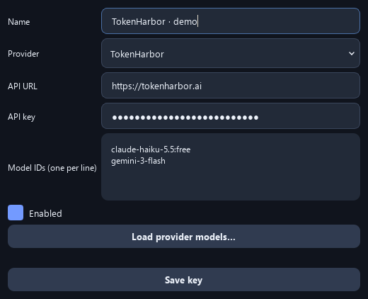
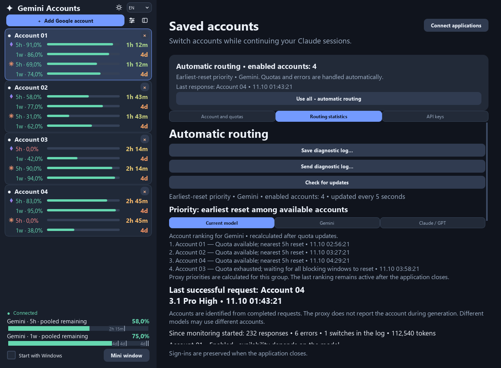

<p align="center">
  
</p>

<p align="center">
  <strong>English</strong> · <a href="README_RU.md">Русский</a>
</p>

<p align="center">
  Google accounts, subscription quotas and independent API keys.<br>
  A Windows desktop app and a CLI for Windows, macOS and Linux.
</p>

<p align="center">
  <a href="https://github.com/stasevboris/Gemini_Accounts/releases/latest"></a>
  <a href="https://github.com/stasevboris/Gemini_Accounts/actions/workflows/build.yml"></a>
  <a href="LICENSE"></a>
  
  
</p>

<p align="center">
  <a href="https://github.com/stasevboris/Gemini_Accounts/releases/latest/download/GeminiAccounts-Setup.exe"><strong>⬇ Download for Windows</strong></a>
  &nbsp;·&nbsp; <a href="#quick-start">Quick start</a>
  &nbsp;·&nbsp; <a href="#screenshots">Screenshots</a>
  &nbsp;·&nbsp; <a href="#terminal">Terminal</a>
  &nbsp;·&nbsp; <a href="#faq">FAQ</a>
</p>

<picture>
  <source media="(prefers-color-scheme: light)" srcset="docs/screenshots/en-dashboard-light.png">
  <source media="(prefers-color-scheme: dark)" srcset="docs/screenshots/en-dashboard-dark.png">
  
</picture>

<p align="center"><sub>Actual application UI with demonstration data. Account addresses are masked; no real keys or sign-ins are shown.</sub></p>

## What you get

| | Feature | In practice |
| :--: | --- | --- |
| ✦ | **Independent model sources** | Google Gemini, Google Claude and API-key models appear alongside each other. Selecting Haiku through a key does not replace Google Opus. |
| ↻ | **Automatic routing** | Uses enabled Google accounts, ranks available quota by reset time and handles provider retries. You can also choose one account manually. |
| ▰ | **Quota dashboard** | Separate 5-hour and weekly values, reset countdowns, pooled totals and a compact window. Missing quota data stays marked as unknown. |
| ⌁ | **API key profiles** | Add, edit, pause or remove keys; choose model IDs and view response, error, token and latency statistics for each key. |
| ⚡ | **Client setup** | Connect Claude Desktop, Claude Code CLI and Codex. Original client configurations are backed up and can be restored. |
| ◐ | **An interface that fits** | Light/dark themes, a system tray and five UI languages: English, Russian, Ukrainian, Belarusian and Chinese. |
| ∑ | **Token estimates** | Approximate tokens available at a chosen quota share, learned from clean usage/quota measurements; resets and mixed-model intervals are excluded. |
| ⏱ | **Credential uptime** | Shows how long an OAuth sign-in remained confirmed. Network errors, rate limits and manual pauses do not count as lost authentication. |
| ◉ | **Grok / xAI** | Separate account pool and model discovery through the local gateway. No 5-hour or weekly bars appear when the gateway reports no quota windows. |
| ◌ | **Alerts and ETA** | Tray alerts for sign-in and quota-reserve transitions, plus an approximate time-to-reserve forecast compared with the next reset. |

<a id="quick-start"></a>
## Up and running

1. **Install.** Download [GeminiAccounts-Setup.exe](https://github.com/stasevboris/Gemini_Accounts/releases/latest/download/GeminiAccounts-Setup.exe) and run it. Python and administrator access are not required.
2. **Add an account or key.** Use **Add Google account** for browser sign-in, or open **API keys → Add API key** for a provider key.
3. **Connect your clients.** Open **Connect applications**, select the clients and review their configuration changes.
4. **Choose a model and work.** Pick Gemini, Claude or a separate API model in your client. Keep the manager running to monitor routing and quotas.

When updating, finish active requests first. The installer preserves existing Google sign-ins. Reopen Claude Desktop after changing API models so its model menu refreshes.

To sign in from a separate browser profile, use **Copy sign-in link** in the Google authorization window and open it in that profile. If the browser stops at `Blocked URL: http://localhost:…`, paste the full callback URL into the same window. The app validates the loopback address and OAuth state, then forwards the callback to the local gateway; it does not save the authorization code in app preferences.

<a id="screenshots"></a>
## A closer look

<table>
  <tr>
    <td width="50%"><strong>API keys, with their own statistics</strong><br><br><a href="docs/screenshots/en-api-keys.png"></a></td>
    <td width="50%"><strong>Requests and account switches</strong><br><br><a href="docs/screenshots/en-request-log.png"></a></td>
  </tr>
  <tr>
    <td><strong>Gemini and Claude selected independently</strong><br><br><a href="docs/screenshots/en-models.png"></a></td>
    <td><strong>Client setup and restoration</strong><br><br><a href="docs/screenshots/en-connections.png"></a></td>
  </tr>
</table>

<details>
<summary><strong>More views: light theme, compact window, key editor and routing priorities</strong></summary>

### Light theme



<table>
  <tr>
    <td width="36%" valign="top"><strong>Compact window</strong><br><br></td>
    <td valign="top"><strong>API key editor</strong><br><br></td>
  </tr>
</table>



</details>

<a id="api-keys"></a>
## Google subscriptions + API keys

The model settings dialog selects the two **Google subscription families**. The **API keys** tab manages additional providers separately.

For example, your Claude Desktop menu can contain:

```text
Gemini · 3.1 Pro High                 ← Google account
Claude · Opus 4.6 Thinking            ← Google account
API · TokenHarbor · Haiku 5.5         ← API key
API · Another profile · Gemini       ← another API profile
```

Each key has a separate model identifier. Two keys to the same model remain separate profiles. Google cooldowns do not block API-key requests; API providers still apply their own access and rate limits.

The Windows key editor supports **TokenHarbor** and **Anthropic-compatible HTTPS APIs**. Load the provider's catalog or enter model IDs, one per line. TokenHarbor supports the Anthropic and OpenAI request routes used by the gateway; a provider exposing only OpenAI endpoints needs an Anthropic adapter to work with Claude Desktop.

Key statistics show observed usage, including retry attempts and provider-reported tokens. They do not estimate your provider balance or remaining quota. [Detailed API-key guide →](docs/API_KEYS.md)

## ChatGPT subscriptions

Use the **ChatGPT** tab to sign in in a normal Firefox tab or import an `auth.json` file you select. The app reads each account’s actual 5-hour and weekly windows, shows its plan when reported, and ranks enabled ChatGPT accounts independently of Google. Pause, remove and test an account without switching the Google pool. Available usage-reset credits are consumed only after confirmation.

Reconnect clients to publish GPT models; reopen Claude Desktop to load its menu. Model labels identify ChatGPT, while local route IDs remain compatible with the client’s model filter. No existing Codex account is imported automatically.

The account-list settings can hide account names throughout the manager. Quota and API-statistics updates keep existing cards in place. API-key fallback tries compatible enabled keys for the same provider URL and exact model, before response content is sent; disable it in a key’s editor if needed.

## Your own Claude subscription accounts

The **Claude** tab adds a separate account pool: sign in in a Firefox tab, import a selected OAuth JSON file, read quotas, test a response, pause and remove accounts. Client models are labeled **Claude subscription** and use the native Claude channel, independently of Google models with the same name. Usage is cached for five minutes; Opus- and Sonnet-specific weekly windows stay separate from the general limit.

Automated checks cover ChatGPT and Claude authentication handling, routing and quotas. Real-account sign-in and generation still need separate verification for this build. [Step-by-step Windows guide →](docs/QUICK_START_EN.md)

## Supported clients

| Client | What is configured |
| --- | --- |
| **Claude Desktop · Windows** | A local gateway preset for the Code tab, including independent API models. Ordinary web chats use their existing connection. |
| **Claude Code CLI** | Gateway URL, local authentication and model defaults in Claude settings. |
| **Codex Desktop / CLI** | A local Responses API provider and model catalog. |

Client setup asks before changing configuration files. **Connect applications → Restore previous settings** restores the saved originals and keeps Google sign-ins.

<a id="terminal"></a>
## Prefer a terminal?

The standalone CLI handles Google sign-in, quotas, verification, model selection, client setup and service monitoring. The graphical API-key editor is part of the Windows desktop app.

| Platform | Download | Run after extraction |
| --- | --- | --- |
| Windows x64 | [CLI ZIP](https://github.com/stasevboris/Gemini_Accounts/releases/latest/download/GeminiAccounts-CLI-windows-x64.zip) | `.\GeminiAccounts-CLI.exe` |
| macOS · Apple Silicon | [ARM64 archive](https://github.com/stasevboris/Gemini_Accounts/releases/latest/download/GeminiAccounts-CLI-macos-arm64.tar.gz) | `./gemini-accounts` |
| macOS · Intel | [x64 archive](https://github.com/stasevboris/Gemini_Accounts/releases/latest/download/GeminiAccounts-CLI-macos-x64.tar.gz) | `./gemini-accounts` |
| Linux x64 | [x64 archive](https://github.com/stasevboris/Gemini_Accounts/releases/latest/download/GeminiAccounts-CLI-linux-x64.tar.gz) | `./gemini-accounts` |

```bash
./gemini-accounts login
./gemini-accounts status
./gemini-accounts configure --clients claude_cli codex
./gemini-accounts serve
```

The first CLI launch downloads the pinned native service and checks its checksum. Keep `serve` or the interactive menu open for monitoring. **Ctrl+C** stops the services started by that invocation. [Full terminal guide →](CLI.md)

## Local storage, clear boundaries

- The client connects to `127.0.0.1:8317`; the native Google gateway listens on `127.0.0.1:8318`. Generation still happens at the selected provider.
- API keys, management secrets and client-configuration backups use **Windows DPAPI** or **Fernet on macOS/Linux**. Google OAuth files remain in the local native credential store.
- Runtime credentials are separate from the source checkout. Release files contain no personal keys, Google sign-ins or conversation history.
- Diagnostics keep request metadata rather than prompts. Account names and full backup archives can still be sensitive; keep personal exports private.

<a id="faq"></a>
## Questions that come up

<details>
<summary><strong>Why does an account show quota but still fail?</strong></summary>

Quota data describes a model group and can be incomplete or cached. It does not prove that a particular model currently accepts requests. Model-specific restrictions, verification and provider-side limits may still apply. Check the model and the latest request event.

</details>

<details>
<summary><strong>Why do I see “rate limit” or a connection-test warning?</strong></summary>

Check the latest gateway event and the response status. Provider limits, denied access and empty test responses are different failures. The manager can retry eligible requests, but it cannot grant missing model access or increase a provider's quota.

</details>

<details>
<summary><strong>Do I need to add the same key again after an update?</strong></summary>

Existing local key profiles and Google sign-ins are preserved. The previous single TokenHarbor key is read as an initial profile and migrated when a profile is saved. Reopen Claude Desktop to refresh its model menu.

</details>

<details>
<summary><strong>Will removing an account delete my Google account?</strong></summary>

It removes the saved local sign-in and its local metadata. It does not delete the Google account. Account removal asks for confirmation.

</details>

<details>
<summary><strong>Can I return clients to their previous settings?</strong></summary>

Yes. Use **Connect applications → Restore previous settings** or `./gemini-accounts restore`. Restore uses the originals saved before the first managed change, so later manual client-config edits may be replaced.

</details>

## Build and contribute

Python **3.12+**. For the Windows desktop app:

```powershell
python -m pip install -r requirements.txt
python app.py
python -m unittest discover -s tests
```

For terminal-only development, install `requirements-cli.txt` and run `python console.py`. Windows release packaging uses `native-patches/build.ps1` followed by `build-release.ps1`; [GitHub Actions](.github/workflows/build.yml) builds and smoke-tests the release platforms.

Found a problem? [Open an issue](https://github.com/stasevboris/Gemini_Accounts/issues) with the version, selected model and error status. Remove personal data from logs and screenshots first.

---

Based on [GeminiAccounts](https://github.com/nikitaeight24family/GeminiAccounts) by nikitaeight24family, with [CLIProxyAPI](https://github.com/router-for-me/CLIProxyAPI) as the native gateway. [MIT license](LICENSE) · [Third-party notices](THIRD_PARTY.md).

<p align="center"><sub>Independent software. Not an official Google, Anthropic or OpenAI product.</sub></p>

## Account priorities and quota reserves

Use the numeric control on each account to set priority from 0 to 999. Higher values go first among available accounts; equal values retain automatic quota/reset ordering. Provider restrictions and exhaustion still apply.

Drag the marker on a quota track, or double-click it to enter a reserve. A 20% reserve stops future requests once 20% remains. The default 0% allows the full quota. Google Gemini/Claude, ChatGPT and Claude subscription windows have independent settings, including Claude model-specific weekly caps. Missing quota holds a configured reserve until refreshed; an active response may cross the boundary before the next measurement.

Collapse account lists and pooled summaries to retain compact quota indicators. The header gear opens language, theme, privacy and service visibility settings from compact mode. Hiding a service keeps its sign-ins, routing and quota polling.

## Compact Claude model menus

Claude Desktop and Claude Code list Google-backed Opus/Sonnet once and show only Gemini 3.8 Flash High, Medium and Low. GPT and explicitly connected API/provider models keep their own entries. Hidden legacy IDs remain valid for existing conversations and background search. Claude Code uses the supported [`modelPicker` setting](https://code.claude.com/docs/en/settings-reference#modelpicker), which requires version 2.1.242 or newer. Restart the client after refreshing its configuration to load the new menu.
