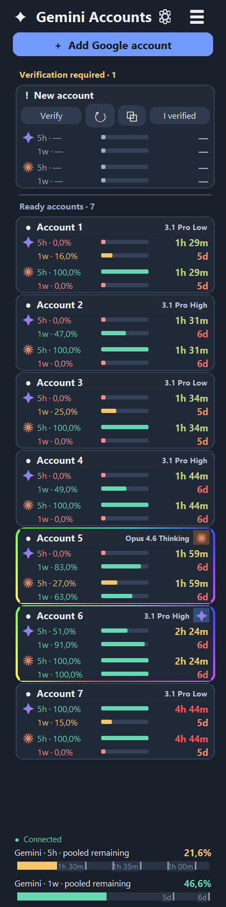

# Gemini Accounts

[English](README.md) | [Русский](README_RU.md)

---

## 🇷🇺 Русский

Менеджер аккаунтов Google Antigravity с мониторингом квот Gemini / Claude и локальным шлюзом для Claude Code и Codex. Доступен в виде **Windows desktop приложения** и **терминального приложения для Windows, macOS и Linux**.

### 🚀 Что это такое?
**Gemini Accounts** — это локальный менеджер аккаунтов и шлюз маршрутизации, который объединяет несколько аккаунтов Google Antigravity. Он предоставляет единый локальный API, к которому могут подключаться ИИ-клиенты (такие как Claude Code и Codex), избавляя от необходимости вручную управлять множеством API-ключей.

#### Основные возможности
- **Автоматическая ротация и переключение:** Отслеживает лимиты квот для нескольких аккаунтов Google и автоматически направляет запросы на аккаунты с доступной квотой.
- **Мониторинг квот:** Отслеживает 5-часовые и недельные квоты для моделей Gemini и Claude, отображая визуальные прогресс-бары и обратный отсчет.
- **Бесшовная интеграция:** Автоматически настраивает поддерживаемые ИИ-клиенты (Claude Desktop, Claude Code CLI, Codex) для работы с локальным шлюзом.
- **Локальный прокси и очереди:** Удерживает запросы в локальной очереди при временном исчерпании квот, предотвращая сбои запросов и поддерживая соединение с клиентами с помощью keep-alive пакетов.
- **Конфиденциальность:** Все конфиденциальные локальные данные (резервные копии, ключи управления, статусы верификации) надежно шифруются с использованием DPAPI в Windows и Fernet в macOS/Linux.

#### Поддерживаемые модели
- **Семейство Gemini:** `gemini-3.1-pro-low`, `gemini-3.1-pro-high`, `gemini-3-flash`, `gemini-3-flash-lite`, `gemini-pro-agent`
- **Семейство Claude (через Antigravity):** `claude-sonnet-4-5`, `claude-sonnet-4-6`, `claude-opus-4-6-thinking`, `claude-haiku-4-5`

*Примечание: Вы можете использовать подписку Gemini Pro от Jio всего за ~1$!*

### 📦 Установка (Windows Desktop)



1. [**Скачайте GeminiAccounts-Setup.exe**](https://github.com/stasevboris/Gemini_Accounts/releases/latest/download/GeminiAccounts-Setup.exe) и нажмите **Install**. Python или права администратора не требуются.
2. Нажмите **Add Google account** и выполните вход в браузере.
3. Откройте **Connect applications** и подтвердите настройку установленных клиентов. Оригинальные конфиги будут сохранены.

*Ярлык будет создан на рабочем столе. При обновлении аккаунты и настройки сохраняются.*

### 💻 Терминал: Windows, macOS и Linux

Скачайте подходящий архив из [Releases](https://github.com/stasevboris/Gemini_Accounts/releases/latest), распакуйте его и откройте терминал в этой папке.

| Платформа | Архив | Команда запуска |
| --- | --- | --- |
| Windows x64 | `GeminiAccounts-CLI-windows-x64.zip` | `.\GeminiAccounts-CLI.exe` |
| Mac (Apple Silicon) | `GeminiAccounts-CLI-macos-arm64.tar.gz` | `./gemini-accounts` |
| Mac (Intel) | `GeminiAccounts-CLI-macos-x64.tar.gz` | `./gemini-accounts` |
| Linux x64 | `GeminiAccounts-CLI-linux-x64.tar.gz` | `./gemini-accounts` |

Используйте интерактивное меню для входа, проверки квот, верификации и настройки клиентов. Нажатие **Ctrl+C** или **Exit** останавливает сервисы.

### 🛠 Стек технологий
- **Язык:** Python 3.12+
- **GUI Фреймворк:** PySide6 (Qt for Python)
- **Библиотеки:** `bcrypt`, `cryptography` (Fernet), `PyYAML`, `ctypes` (DPAPI)
- **Нативный прокси:** Внешний Go-бинарник (`CLIProxyAPI`), работающий на `127.0.0.1:8318`
- **Локальный шлюз:** `ThreadingHTTPServer`, работающий на `127.0.0.1:8317`

### ⚙️ Подключения и восстановление

| Клиент | Изменения после подтверждения |
| --- | --- |
| **Claude Desktop (Windows)** | Локальный пресет шлюза для вкладки Code. Обычные веб-чаты сохраняют свое собственное подключение. |
| **Claude Code CLI (Все)** | URL шлюза, локальный ключ и дефолтные модели интегрируются в `~/.claude/settings.json`. |
| **Codex (Windows / CLI)** | Настраивается провайдер API и локальный каталог моделей в `~/.codex/config.toml`. |

**Восстановление:** в десктоп-версии **☰ → Connect applications → Restore previous settings / reset preferences**, или в терминале `./gemini-accounts restore`. Входы в Google сохраняются.

### 🛡️ Конфиденциальность и хранение
- Шлюз (`127.0.0.1:8317`) и нативный сервис (`127.0.0.1:8318`) работают исключительно локально.
- Каждая установка генерирует случайные ключи. **Релизы не содержат личных входов, закрытых ключей или истории.**
- Windows использует DPAPI для защиты ключей управления и бэкапов.
- Mac / Linux шифруют файлы с помощью Fernet и локального ключа хранилища пользователя.

### 🔨 Разработка
Требования: Python 3.12+
```sh
python -m pip install -r requirements-cli.txt
python console.py --help
python -m unittest discover -s tests
```

*Это независимый проект, не являющийся официальным приложением Google, Anthropic или OpenAI.*
