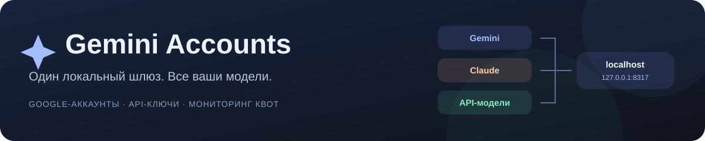
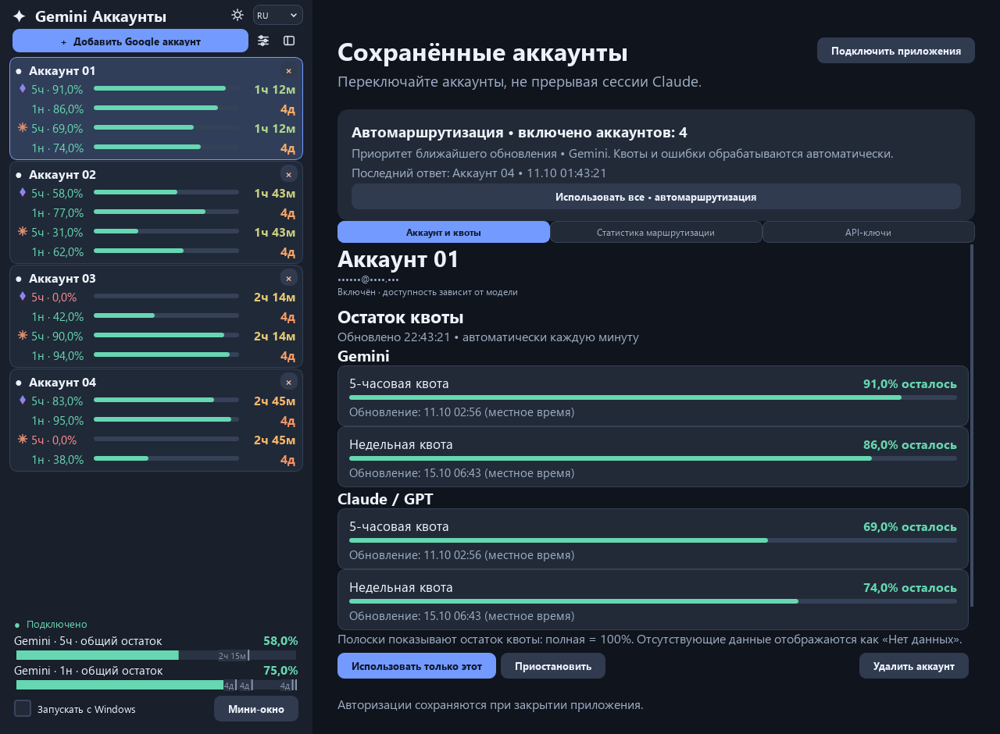
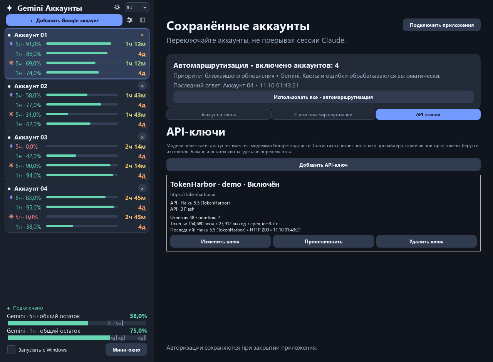
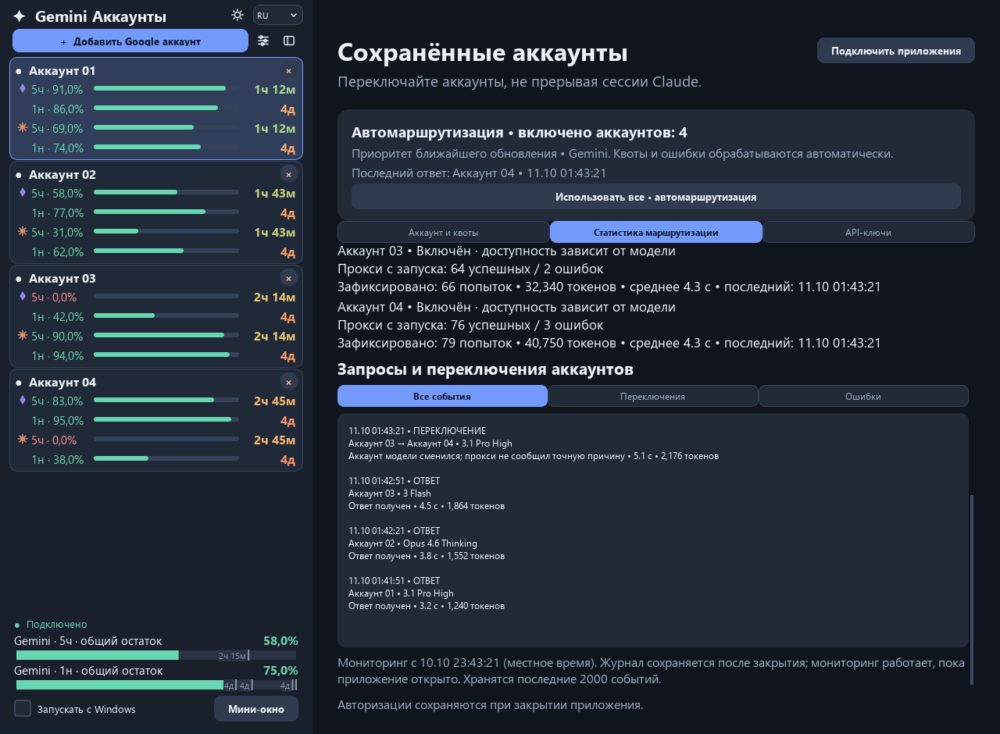
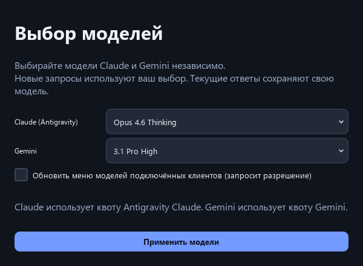
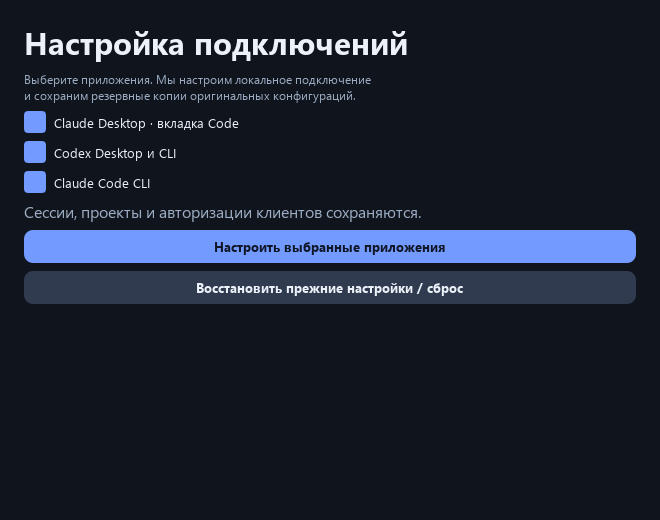
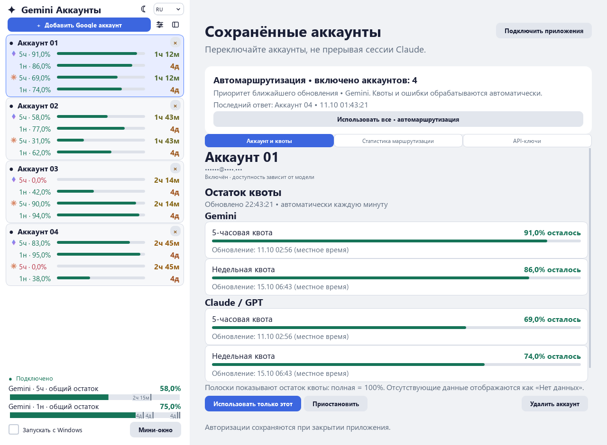
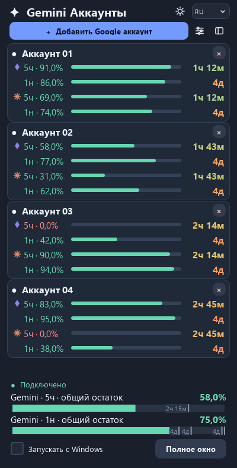
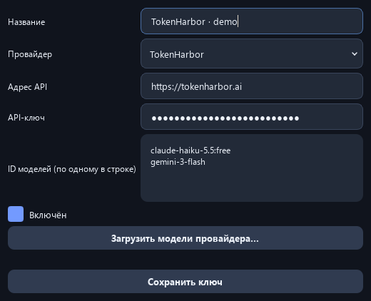
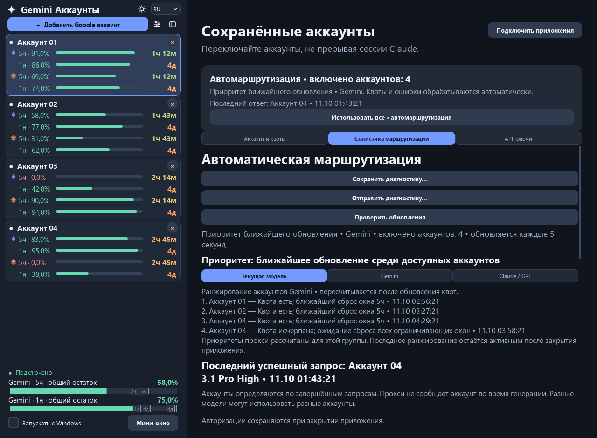

<p align="center">
  
</p>

<p align="center">
  <a href="README.md">English</a> · <strong>Русский</strong>
</p>

<p align="center">
  Google-аккаунты, квоты подписок и отдельные API-ключи.<br>
  Приложение для Windows и терминальная версия для Windows, macOS и Linux.
</p>

<p align="center">
  <a href="https://github.com/stasevboris/Gemini_Accounts/releases/latest"></a>
  <a href="https://github.com/stasevboris/Gemini_Accounts/actions/workflows/build.yml"></a>
  <a href="LICENSE"></a>
  
  
</p>

<p align="center">
  <a href="https://github.com/stasevboris/Gemini_Accounts/releases/latest/download/GeminiAccounts-Setup.exe"><strong>⬇ Скачать для Windows</strong></a>
  &nbsp;·&nbsp; <a href="#quick-start">Быстрый старт</a>
  &nbsp;·&nbsp; <a href="#screenshots">Скриншоты</a>
  &nbsp;·&nbsp; <a href="#terminal">Терминал</a>
  &nbsp;·&nbsp; <a href="#faq">Вопросы</a>
</p>

<picture>
  <source media="(prefers-color-scheme: light)" srcset="docs/screenshots/ru-dashboard-light.png">
  <source media="(prefers-color-scheme: dark)" srcset="docs/screenshots/ru-dashboard-dark.png">
  
</picture>

<p align="center"><sub>Реальный интерфейс приложения с демонстрационными данными. Почта скрыта; настоящих ключей и сохранённых входов на скриншотах нет.</sub></p>

## Что умеет приложение

| | Возможность | Что это даёт |
| :--: | --- | --- |
| ✦ | **Отдельные источники моделей** | Google Gemini, Google Claude и модели через ключи доступны одновременно. Выбор Haiku через API не заменяет Google Opus. |
| ↻ | **Автоматическая маршрутизация** | Выбирает включённые Google-аккаунты с доступной квотой, учитывает время её обновления и обрабатывает повторы. Можно выбрать один аккаунт вручную. |
| ▰ | **Панель квот** | Отдельные значения за 5 часов и неделю, таймеры, общий остаток и компактное окно. Отсутствующие данные не превращаются в выдуманные проценты. |
| ⌁ | **Профили API-ключей** | Добавление, изменение, приостановка и удаление ключей. Свои модели, ответы, ошибки, токены и среднее время для каждого профиля. |
| ⚡ | **Подключение клиентов** | Настраивает Claude Desktop, Claude Code CLI и Codex, сохраняя копии прежних конфигураций для восстановления. |
| ◐ | **Удобный интерфейс** | Светлая и тёмная темы, трей и пять языков интерфейса: английский, русский, украинский, белорусский и китайский. |

<a id="quick-start"></a>
## Начать за несколько шагов

1. **Установите приложение.** Скачайте [GeminiAccounts-Setup.exe](https://github.com/stasevboris/Gemini_Accounts/releases/latest/download/GeminiAccounts-Setup.exe) и запустите установку. Python и права администратора не нужны.
2. **Добавьте аккаунт или ключ.** Для входа через браузер нажмите **Добавить Google аккаунт**. Для стороннего провайдера откройте **API-ключи → Добавить API-ключ**.
3. **Подключите клиент.** Откройте **Подключить приложения**, отметьте нужные клиенты и проверьте изменения их настроек.
4. **Выберите модель и работайте.** В клиенте появятся Gemini, Claude и отдельные API-модели. Оставьте менеджер открытым для мониторинга квот и маршрутизации.

Перед обновлением дождитесь окончания активных запросов. Установщик сохраняет Google-входы. После изменения API-моделей переоткройте Claude Desktop, чтобы обновилось его меню.

<a id="screenshots"></a>
## Посмотреть поближе

<table>
  <tr>
    <td width="50%"><strong>API-ключи и отдельная статистика</strong><br><br><a href="docs/screenshots/ru-api-keys.png"></a></td>
    <td width="50%"><strong>Запросы и переключения аккаунтов</strong><br><br><a href="docs/screenshots/ru-request-log.png"></a></td>
  </tr>
  <tr>
    <td><strong>Независимый выбор Gemini и Claude</strong><br><br><a href="docs/screenshots/ru-models.png"></a></td>
    <td><strong>Подключение и восстановление клиентов</strong><br><br><a href="docs/screenshots/ru-connections.png"></a></td>
  </tr>
</table>

<details>
<summary><strong>Ещё скриншоты: светлая тема, мини-окно, редактор ключа и приоритеты</strong></summary>

### Светлая тема



<table>
  <tr>
    <td width="36%" valign="top"><strong>Компактное окно</strong><br><br></td>
    <td valign="top"><strong>Редактор API-ключа</strong><br><br></td>
  </tr>
</table>



</details>

<a id="api-keys"></a>
## Подписки Google + API-ключи

Окно выбора моделей управляет двумя **семействами Google-подписки**. Вкладка **API-ключи** добавляет другие источники отдельно.

Например, в меню Claude Desktop могут одновременно находиться:

```text
Gemini · 3.1 Pro High                 ← Google-аккаунт
Claude · Opus 4.6 Thinking            ← Google-аккаунт
API · TokenHarbor · Haiku 5.5         ← API-ключ
API · Другой профиль · Gemini        ← ещё один API-профиль
```

У каждого ключа собственный идентификатор модели. Два ключа к одной модели остаются разными профилями. Ожидание квот Google не блокирует API-запросы; у API-провайдера действуют свои ограничения доступа и частоты.

Редактор в Windows поддерживает **TokenHarbor** и **HTTPS API, совместимые с Anthropic**. Загрузите каталог провайдера или впишите ID моделей по одному в строке. TokenHarbor поддерживает используемые шлюзом форматы Anthropic и OpenAI. Для провайдера только с OpenAI API понадобится адаптер Anthropic, чтобы подключить его к Claude Desktop.

Статистика показывает фактические попытки, включая повторы, и токены из ответов провайдера. Она не вычисляет баланс или процент оставшейся квоты. [Подробная инструкция по ключам →](docs/TOKENHARBOR_RU.md)

## С какими клиентами работает

| Клиент | Что настраивается |
| --- | --- |
| **Claude Desktop · Windows** | Локальный пресет шлюза для вкладки Code, включая отдельные API-модели. Обычные веб-чаты используют прежнее подключение. |
| **Claude Code CLI** | Адрес шлюза, локальный ключ и модели по умолчанию в настройках Claude. |
| **Codex Desktop / CLI** | Локальный провайдер Responses API и каталог моделей. |

Перед изменением файлов настроек приложение спрашивает подтверждение. **Подключить приложения → Восстановить прежние настройки** возвращает сохранённые конфигурации и сохраняет Google-входы.

<a id="terminal"></a>
## Если удобнее терминал

CLI умеет добавлять Google-аккаунты, показывать квоты, проверять верификацию, выбирать модели, подключать клиенты и запускать мониторинг. Графический редактор API-ключей доступен в Windows-приложении.

| Платформа | Скачать | Запуск после распаковки |
| --- | --- | --- |
| Windows x64 | [CLI ZIP](https://github.com/stasevboris/Gemini_Accounts/releases/latest/download/GeminiAccounts-CLI-windows-x64.zip) | `.\GeminiAccounts-CLI.exe` |
| macOS · Apple Silicon | [Архив ARM64](https://github.com/stasevboris/Gemini_Accounts/releases/latest/download/GeminiAccounts-CLI-macos-arm64.tar.gz) | `./gemini-accounts` |
| macOS · Intel | [Архив x64](https://github.com/stasevboris/Gemini_Accounts/releases/latest/download/GeminiAccounts-CLI-macos-x64.tar.gz) | `./gemini-accounts` |
| Linux x64 | [Архив x64](https://github.com/stasevboris/Gemini_Accounts/releases/latest/download/GeminiAccounts-CLI-linux-x64.tar.gz) | `./gemini-accounts` |

```bash
./gemini-accounts login
./gemini-accounts status
./gemini-accounts configure --clients claude_cli codex
./gemini-accounts serve
```

При первом запуске CLI скачивает закреплённую версию нативного сервиса и проверяет контрольную сумму. Для мониторинга оставьте `serve` или интерактивное меню открытым. **Ctrl+C** останавливает сервисы, запущенные этим процессом. [Полная инструкция для терминала →](CLI.md)

## Данные остаются в своём месте

- Клиент подключается к `127.0.0.1:8317`, нативный Google-шлюз слушает `127.0.0.1:8318`. Генерацию выполняет выбранный провайдер.
- API-ключи, ключи управления и копии конфигураций клиентов защищаются **DPAPI в Windows** или **Fernet в macOS/Linux**. Google OAuth-файлы хранятся локально у нативного сервиса.
- Личные данные хранятся отдельно от исходников. Релизы не содержат чужих ключей, Google-входов или истории переписки.
- Диагностика хранит метаданные запросов, а не промпты. Имена аккаунтов и полные архивы резервных копий могут быть чувствительными — личные выгрузки не стоит публиковать.

<a id="faq"></a>
## Частые вопросы

<details>
<summary><strong>Почему квота есть, а аккаунт не отвечает?</strong></summary>

Квота относится к группе моделей, а данные могут быть неполными или кэшированными. Проценты не подтверждают доступность конкретной модели прямо сейчас. Возможны ограничения модели, верификация или лимиты провайдера. Проверьте выбранную модель и последнее событие запроса.

</details>

<details>
<summary><strong>Что означает rate limit или предупреждение проверки подключения?</strong></summary>

Посмотрите последнее событие шлюза и код ответа. Лимит провайдера, отказ в доступе и пустой тестовый ответ — разные ситуации. Менеджер может повторить подходящий запрос, но не выдаёт отсутствующий доступ к модели и не увеличивает квоту провайдера.

</details>

<details>
<summary><strong>После обновления придётся заново вводить ключ?</strong></summary>

Локальные профили ключей и Google-входы сохраняются. Прежний одиночный ключ TokenHarbor читается как исходный профиль и переносится при сохранении профиля. Для обновления меню моделей переоткройте Claude Desktop.

</details>

<details>
<summary><strong>Удаление аккаунта удалит мой Google-аккаунт?</strong></summary>

Удаляется сохранённый локальный вход и его метаданные. Сам Google-аккаунт остаётся. Перед удалением приложение показывает подтверждение.

</details>

<details>
<summary><strong>Можно вернуть клиентам прежние настройки?</strong></summary>

Да: **Подключить приложения → Восстановить прежние настройки** или `./gemini-accounts restore`. Возвращаются оригиналы, сохранённые до первого изменения менеджером, поэтому более поздние ручные правки конфигурации клиента могут замениться.

</details>

## Разработка и участие

Python **3.12+**. Для Windows-приложения:

```powershell
python -m pip install -r requirements.txt
python app.py
python -m unittest discover -s tests
```

Для терминальной версии достаточно `requirements-cli.txt` и команды `python console.py`. Сборка Windows-релиза выполняется через `native-patches/build.ps1`, затем `build-release.ps1`. [GitHub Actions](.github/workflows/build.yml) собирает и проверяет запуск версий для поддерживаемых платформ.

Нашли ошибку? [Создайте issue](https://github.com/stasevboris/Gemini_Accounts/issues), укажите версию, модель и код ошибки. Перед отправкой логов и скриншотов удалите личные данные.

---

Основано на [GeminiAccounts](https://github.com/nikitaeight24family/GeminiAccounts) от nikitaeight24family. Нативный шлюз — [CLIProxyAPI](https://github.com/router-for-me/CLIProxyAPI). [Лицензия MIT](LICENSE) · [Сторонние компоненты](THIRD_PARTY.md).

<p align="center"><sub>Независимый проект. Не является официальным приложением Google, Anthropic или OpenAI.</sub></p>
